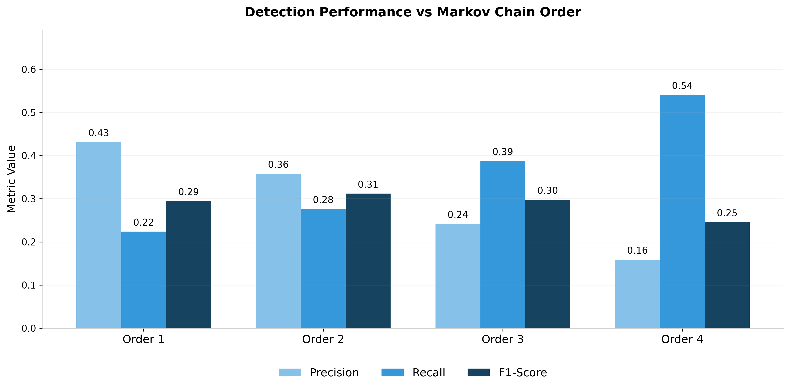
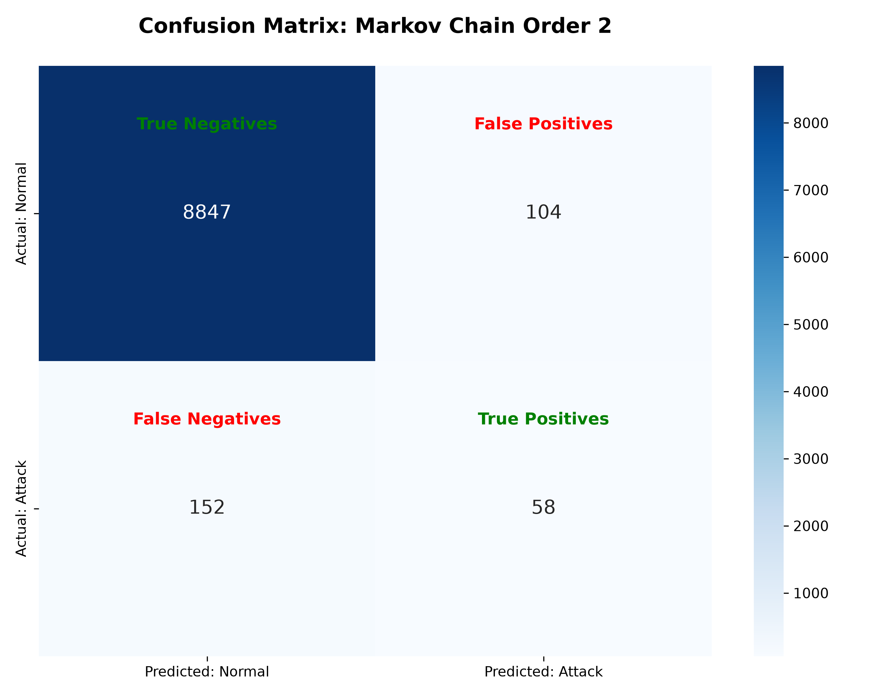
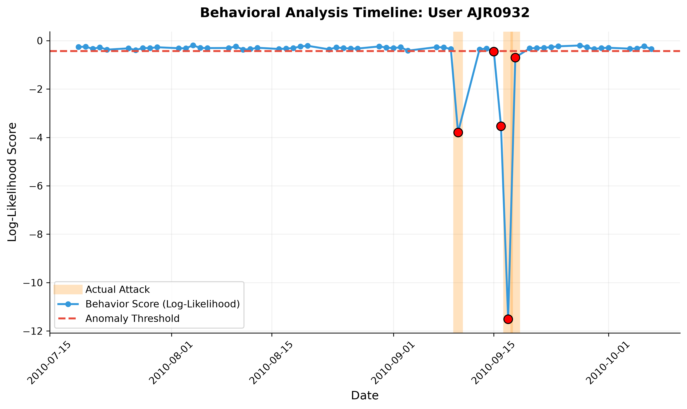

# Behavioral Anomaly Detection: Insider Threat Analysis 🕵️‍♂️

> **🚨 Note: This project is a Proof of Concept (PoC).** 
> It is designed as an exploratory data science project rather than a production-ready security tool. While the baseline Markov Chain approach effectively demonstrates sequence-based behavioral modeling, it has limitations in real-world efficacy and scale. 

This repository contains a robust data pipeline and Machine Learning model that detects malicious insider activities within corporate networks. By analyzing chronological sequences of user actions (logons, file accesses, HTTP requests) using **Markov Chains**, the system calculates the log-likelihood of behavior sequences and flags anomalies when a user deviates significantly from their historical baseline.

## 🔬 Methodology & Targeted Sampling

The original CERT dataset contains thousands of users with a massive class imbalance (thousands of benign employees versus a handful of insiders). To effectively evaluate the model and make the results more visible for this PoC, we apply a targeted data sampling methodology:

* The system isolates active users and known insiders from the raw logs.
* It randomly samples a highly focused subset of exactly **100 users**: **80 normal employees** and **20 malicious insiders**. 
* This artificially balanced sample is intentionally designed to highlight the detection metrics, making the confusion matrices and performance comparisons much easier to analyze and interpret without being completely overshadowed by benign data.

## 📊 Project Architecture

The codebase is modularized for scalability and memory efficiency:
- **`data_builder.py`**: A memory-safe data engineering module that uses chunking to process gigabytes of raw logs, samples target users, and constructs the Ground Truth from scenario answer keys.
- **`markov_utils.py`**: The core data science engine. Contains the mathematical implementation of Markov Chain transition matrices, log-likelihood scoring, baseline calculation (3-sigma rule), and visualization generators.
- **`main.py`**: The execution pipeline that orchestrates data preparation, iterates through Markov Chain orders (1-4), evaluates performance, and outputs analytical plots.
## 💾 Dataset Setup

This project uses the official **CERT Insider Threat Dataset (v4.2)** developed by Carnegie Mellon University (CMU). 
*Due to GitHub's file size limits, the raw dataset is not included in this repository.*

**How to get the data:**
1. Download the r4.2.tar.bz2 and answers.tar.bz2 files from the official CMU KiltHub Repository ([https://kilthub.cmu.edu/articles/dataset/Insider_Threat_Test_Dataset/12841247](https://kilthub.cmu.edu/articles/dataset/Insider_Threat_Test_Dataset/12841247)).
2. Extract the archives.
3. Create a folder named data in the root directory of this project.
4. Move the extracted r4.2 and answers folders into the data directory. 

Your directory structure should look exactly like this:

    ├── data/
    │   ├── r4.2/              # logon.csv, http.csv, file.csv, etc.
    │   └── answers/           # insiders.csv, r4.2-1/, r4.2-2/, etc.
    ├── data_builder.py
    ├── main.py
    ├── markov_utils.py
    ├── requirements.txt
    └── README.md

## 🚀 Installation & Usage

1. **Clone the repository:**
    git clone [https://github.com/YOUR_USERNAME/YOUR_REPOSITORY_NAME.git](https://github.com/YOUR_USERNAME/YOUR_REPOSITORY_NAME.git)
    cd YOUR_REPOSITORY_NAME

2. **Install dependencies:**
    pip install -r requirements.txt

3. **Run the pipeline:**
    python main.py
   
    *Note: On the first run, the script will automatically parse the massive raw CSVs and generate a lightweight sample_dataset.csv and ground_truth.csv.*

## 📈 Results & Visualizations

The model evaluates user behavior against different complexities (Orders) of Markov Chains. An Order of N means the next action depends on the previous N actions.

### 1. Performance Comparison
Comparison of Precision, Recall, and F1-Score across Markov Chains of Order 1 through 4.

### 2. Confusion Matrix (Best Model)
Detailed breakdown of True Positives (caught attacks) and False Positives (false alarms) for our optimal configuration.

### 3. Attack Anatomy: Hacker Timeline
A timeline visualizing a malicious insider's behavior score dropping significantly below their normal historical threshold during an attack phase.

---
*Built with Python, Pandas, Scikit-Learn, and Seaborn.*
